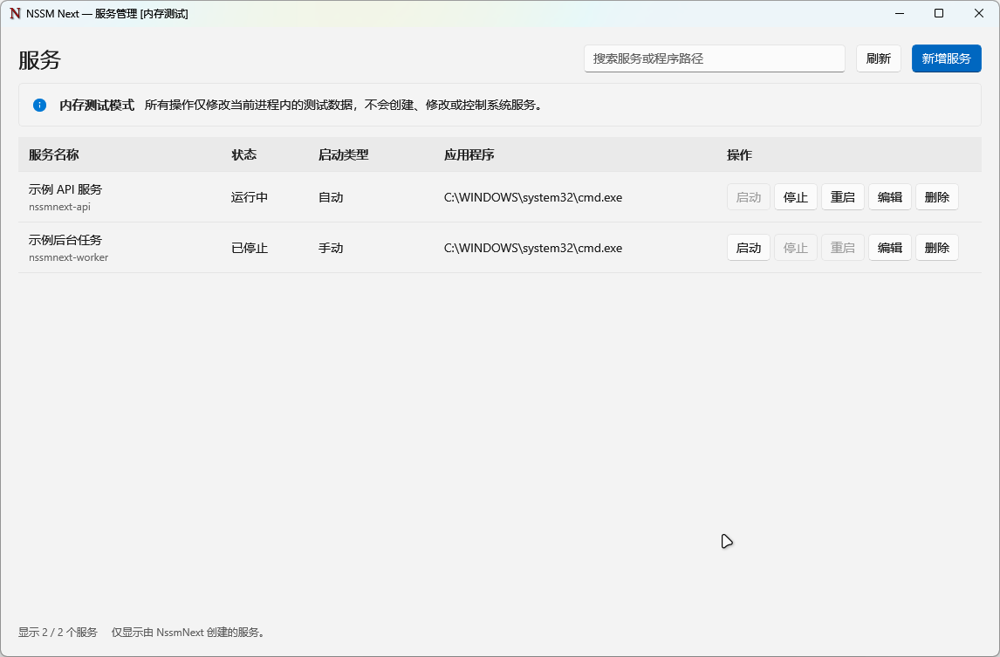
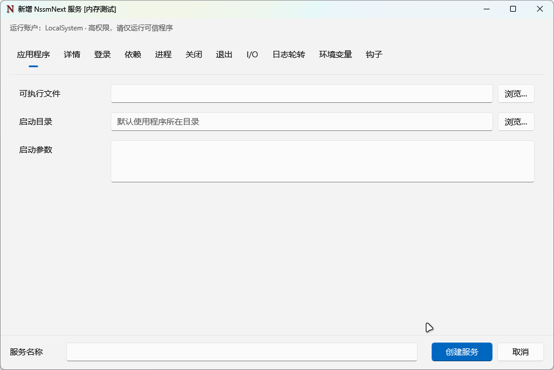

# NSSM Next

基于 **C++ / WinUI 3** 的 Windows 服务管理器。保留 NSSM 熟悉的配置分组，提供简洁的服务表格和原生服务宿主；双击即可打开，不需要命令行参数。

[](https://github.com/pedoc/nssm/actions/workflows/next-release.yml)
[预发行版本](https://github.com/pedoc/nssm/releases?q=next-v&expanded=true) · [构建产物](https://github.com/pedoc/nssm/actions/workflows/next-release.yml) · [功能矩阵](docs/gui-feature-parity.md)

> 当前为预览版本，仅管理由 **NssmNext 创建**的服务，不自动导入或修改旧 NSSM／其他 Windows 服务。旧版 NSSM 的程序和发布流程保持独立。

## 界面预览

### 服务管理

表格展示服务名称、状态、启动类型和应用程序，最后一列提供启动、停止、重启、编辑和删除；支持搜索与刷新。



### 新增与编辑

沿用旧版 NSSM 的 11 个配置分类，采用 WinUI 横向导航、对齐表单和底部保存区。选择程序后自动填写启动目录和新服务名称；手动修改过的内容不会被覆盖。



*截图来自独立的内存预览版，服务列表为模拟数据；标题中的“内存测试”和主页提示不会出现在正常管理员模式中。截图不包含真实服务或凭据，也不代表所有高级配置已完成原生运行验收。*

## 功能

| 配置页 | 内容 |
| --- | --- |
| 应用程序 | 可执行文件、启动目录、启动参数、路径浏览与自动填写 |
| 详情 | 显示名称、描述、自动／延迟自动／手动／禁用启动 |
| 登录 | 系统账户、低权限内置账户、虚拟账户和自定义账户 |
| 依赖 | 服务与加载顺序组依赖 |
| 进程 | 优先级、CPU 亲和性、控制台选项 |
| 关闭 | Ctrl-C、窗口／线程消息、强制终止、超时与进程树 |
| 退出 | 退出动作、重启延迟与快速失败节流 |
| I/O | 标准输入、输出、错误重定向与时间戳 |
| 日志轮转 | 追加／覆盖、在线轮转、文件年龄与 64 位大小阈值 |
| 环境变量 | 替换与追加环境块 |
| 钩子 | 启动、停止、退出、电源与轮转事件命令 |

- 新增服务后**不会自动启动**；编辑保存后，运行中的服务需重启才能应用相关配置。
- 服务名称在创建后不可修改。重启、删除需要确认；删除只移除服务注册，不删除应用、日志或宿主文件。
- 查看列表不需要管理员权限；写操作会明确请求 UAC 提权。
- 默认运行账户为 **LocalSystem**，具有较高系统权限。仅托管可信程序，按需要改用低权限账户。
- 密码只用于本次安全提交，不保存到配置快照、日志或命令行。

## 下载与运行

支持 x64 Windows 10（项目最低版本 19041）／Windows 11；当前不提供 x86 或 ARM64 构建。

1. 在 [Releases](https://github.com/pedoc/nssm/releases?q=next-v&expanded=true) 中选择 **NSSM Next** 预发行版，而非旧版 `nssm-win32.zip`／`nssm-win64.zip`。
2. 下载 `NssmNext-<版本>-win-x64.zip` 和 `SHA256SUMS.txt`，核对校验值。
3. 完整解压 ZIP，进入 `NssmNext` 文件夹，双击 **`NssmNext.exe`**。

**不要只复制 EXE。** 自包含运行目录中的 DLL、PRI、XBF、语言资源及 `NssmNext.ServiceHost.exe` 必须一并保留，不需要单独安装 WinUI 运行时。当前发布未做代码签名，Windows 可能显示信誉提示；请核实来源和 SHA256，不要关闭系统安全防护。

```powershell
Get-FileHash .\NssmNext-3.0.2-preview.1-win-x64.zip -Algorithm SHA256
```

服务创建时会把原生宿主按内容哈希部署到受保护的 `Program Files\NssmNext\ServiceHosts`，避免 SYSTEM 从可被普通用户替换的下载／Scoop 目录启动宿主。目标应用、工作目录和日志仍需要正确设置运行账户的访问权限。

## 本地构建

需要 Visual Studio 的 C++ 桌面开发组件、Windows SDK 和 PowerShell 7。构建脚本自动定位 Visual Studio 与已安装 SDK；依赖版本由 NuGet 锁定。

在仓库根目录运行：

```powershell
pwsh -NoProfile -File next/build/build.ps1 -Project App
```

输出：`next/out/x64/Release/NssmNext.exe`。App 构建同时编译原生服务宿主。

NuGet 网络访问失败时可指定代理：

```powershell
pwsh -NoProfile -File next/build/build.ps1 -Project App -Proxy http://127.0.0.1:10808
```

### 安全的界面预览

内存预览版的写操作只修改当前进程中的模拟数据，不会创建、修改或控制系统服务。该模式是独立的编译选项，正常版不能通过运行参数切换到内存模式。

```powershell
pwsh -NoProfile -File next/build/build.ps1 -Project App -UiTestBackend
./next/out/UiTests/x64/Release/NssmNext.exe
```

需要更新文档截图时，先构建 Capture 项目，再指定一个**新的空输出目录**；脚本仅打开内存版主页和空白应用程序页，不提交配置或打开凭据页：

```powershell
pwsh -NoProfile -File next/build/build.ps1 -Project Capture
pwsh -NoProfile -File next/build/capture-docs.ps1 -OutputDirectory next/out/readme-images-new
```

## CI / CD

[`.github/workflows/next-release.yml`](https://github.com/pedoc/nssm/blob/feat/winui3-unified-prototype/.github/workflows/next-release.yml) 负责 Next 构建和发布，与旧版 NSSM 的 `build.yml` 独立。

| 触发方式 | 结果 |
| --- | --- |
| 推送实验分支或 `main`，且命中 Next 路径 | 自动检查、编译、打包并上传 Actions Artifact，不创建 Release |
| 相关 Pull Request | 同样检查和构建，不发布 |
| 推送 `next-vX.Y.Z` 或 `next-vX.Y.Z-preview.N` 标签 | 全部检查成功后自动发布 **NSSM Next 预发行版** |
| 手动运行工作流 | 分支运行只产生产物；标签运行可完成该标签的发布 |

发布流程：

1. 校验标签格式、版本与 `version.h` 一致，执行静态安全契约、脚本语法和原生路由／内存配置测试。
2. 在 Windows runner 编译正常版 GUI 和原生宿主，不打包测试后端。
3. 保留完整运行目录与第三方许可，排除 PDB、LIB、ILK 等调试／构建文件及测试程序。
4. 验证 x64 PE／GUI 子系统，逐文件复核 ZIP 内的长度与 SHA256，并生成 ZIP 校验值。
5. 创建 Release **草稿**，上传资产，下载复核后才公开为预发行版；再检查公开下载地址。不会替换旧版的 Latest，也不会覆盖已有 Release。

示例：当 `version.h` 的版本是 `3.0.2` 时，在准备发布的提交上执行：

```bash
git tag -a next-v3.0.2-preview.1 -m "NSSM Next 3.0.2 preview 1"
git push origin next-v3.0.2-preview.1
```

标签必须指向包含此工作流的提交，已发布标签不应改写。若发布中途失败，先检查 Actions 日志及草稿资产，不要直接删除、覆盖或反复重建版本。

发布资产包括运行 ZIP 和 `SHA256SUMS.txt`；ZIP 内附 `BUILDINFO.json`（版本、源提交、架构与后端）及 `FILELIST.json`（文件清单与校验值）。

### 验证边界

日常界面效果由用户手动确认，不要求反复运行自动 GUI 验收。上述发布流水线不启动 GUI，也不创建真实服务。独立的 `next-compat.yml` 仍只在获授权的实验分支、一次性 GitHub-hosted Windows runner 上执行真实 SCM 集成；不会在本机运行。

完整运行目录的干净机器部署、高级账户及各项运行策略仍需按 [功能矩阵](docs/gui-feature-parity.md) 分项确认，不能把“编译通过”当作所有运行行为已验收。

## 许可与说明

原 NSSM 源码保留 Public Domain 声明；新界面所用依赖的许可见 [THIRD_PARTY_NOTICES.md](THIRD_PARTY_NOTICES.md)，发布包同时包含实际 NuGet 依赖的许可与 NOTICE 文件。服务宿主沿用原生监督引擎，不通过旧版修改服务的 CLI 命令转发，也不改写旧 NSSM 的事件源。
